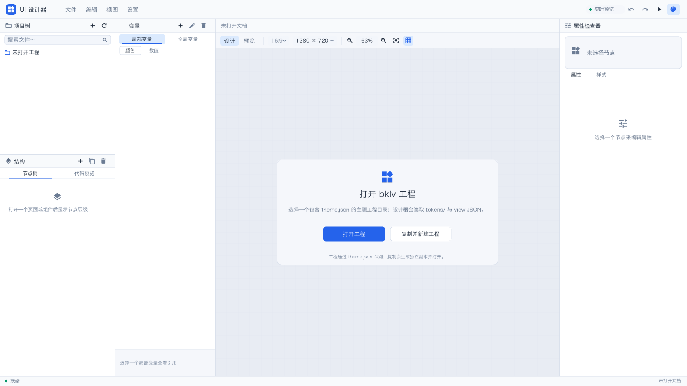
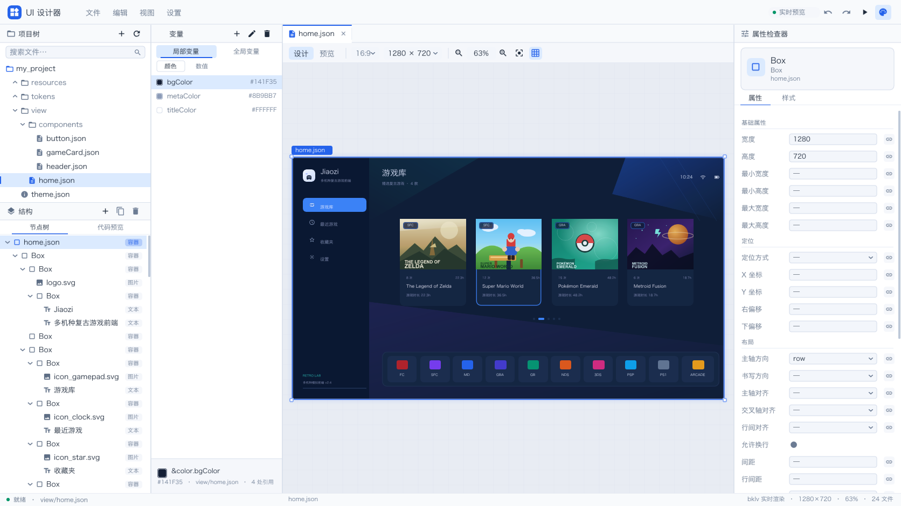

# Belive Designer

基于 [BekUI](https://github.com/beiklive/BekUI)（bklv）的 JSON UI 设计器。

设计器直接实例化 bklv 的视图 JSON（`type` + 平铺属性 + `children`），
不把属性包在自定义 `style` 对象里；全局变量来自主题 `tokens/`，局部变量来自
当前 JSON 顶层的 `vars`。

## 构建

```bash
git submodule update --init --recursive
cmake -S . -B build/gl -G Ninja -DCMAKE_BUILD_TYPE=Release
cmake --build build/gl
```

产物在 `dist/designer`。构建后会自动同步 `BekUI/resources` 与 `projects/` 到 `dist/`。

## 运行

```bash
./dist/designer
```

启动后是空界面，点击「打开工程」或「复制并新建工程」；也可以直接指定工程目录：

```bash
./dist/designer --project projects/my_project
./dist/designer --project projects/my_project --open view/home.json
./dist/designer --screenshot /tmp/designer.png --frames 20
```

「打开工程」和「复制并新建工程」都会调用系统原生文件夹选择器。工程以目录中的
`theme.json` 为唯一识别依据；没有 `theme.json` 的目录会被拒绝。

## 工程格式

示例工程 `projects/my_project` 是一个可被 bklv 读取的主题目录：

```text
my_project/
  theme.json                 # 主题元信息 + files[] 清单
  tokens/colors.json         # 全局颜色：color.*
  tokens/metrics.json        # 全局数值：metric.*
  view/home.json             # 页面 / 视图 JSON
  view/components/*.json     # 可复用的视图 JSON
  resources/assets/*.svg     # @res/ 资源
```

视图 JSON 使用 bklv 原生字段，例如：

```json
{
  "type": "Box",
  "axis": "row",
  "gap": 12,
  "backgroundColor": "@theme/color.surface",
  "vars": {
    "colors": { "accent": "@theme/color.accent" },
    "numbers": { "radius": 14 }
  },
  "children": [
    { "type": "Label", "text": "Hello", "fontSize": 16,
      "textColor": "&color.accent", "cornerRadius": "&number.radius" }
  ]
}
```

变量规则：

| 作用域 | 定义位置 | 引用写法 |
|---|---|---|
| 全局 | `tokens/colors.json` / `tokens/metrics.json` | 颜色 `@theme/color.…`，数值 `@style/metric.…` |
| 局部 | 当前视图 JSON 顶层 `vars.colors` / `vars.numbers` | `&color.…` / `&number.…` |

## 功能

- **全局变量**：从主题 `tokens` 读取 `color.*` / `metric.*`；变量面板的「全局变量」页签展示、拖拽引用、双击编辑。
- **局部变量**：「变量」面板默认显示当前 JSON 的 `vars`，分颜色/数值；可新建、改名、删除，拖到属性行写入 `&color.…` / `&number.…`。
- **属性检查器**：只保留「属性 / 样式」两个页签；按 bklv 字段生成尺寸、定位、布局、文本、图片、外观字段。
- **节点树 / 代码预览**：左侧两个页签；代码页签支持当前节点/整篇文档、编辑、应用、还原、错误提示。
- **节点树创建/导入**：视图树可新建 Box/Label/Image/Button；外观树可新建 rect/text/image/shadow/glass/custom 图层、从工程外观 JSON 导入、删除/复制图层；导入节点点击打开源文件。
- **打开主题工程**：自动选择有内容的 view（优先 home/page，而不是 `children_ref_demo` 这类占位页）；局部变量为空时变量面板自动切到「全局变量」。
- **外观 JSON**：`base/`、`demo/` 下的外观/组合 JSON 用 bklv `AppearanceView::applyAppearanceJson` 直接渲染；透明区域用棋盘格衬底。节点树递归解析 `layers[]` 和 `import`（字符串/数组导入、多层导入展开，点击导入节点会打开源文件并选中对应层，循环/缺失会标注），选中本文件图层会定位到属性检查器。属性检查器可编辑 `box` 和每个 `layer` 的字段（op/id/fill/stroke/radius/fontSize/inset 等），改动实时重编译预览。代码页仍可编辑。
- **主题/变量 JSON**：`theme.json` 在画布中央显示主题清单；`tokens/` 显示颜色/数值变量表。代码页仍可编辑。
- **原生工程流程**：打开工程；复制源工程到新目录并生成独立副本，自动更新 `theme.json` 的 name/description 后打开。
- **bklv 真实预览**：直接实例化视图 JSON，`@theme/`、`@style/`、`&color/&number` 由 bklv 解析；图片 `@res/` 指向当前工程 `resources/`。
- **Button 节点**：使用真实 bklv Button，可编辑文字、图标、图标字体、variant、enabled；外观由 bklv 主题决定。
- **浅色 / 深色主题**：默认浅色；深色采用 VS Code Dark+ 配色，右上角调色板或设置菜单切换。
- **基础字号**：默认使用大号界面字号（1.15×），设置菜单可切小/标准/大或逐步增减。
- 撤销/重做、保存（临时文件 + rename + `.bak`）、另存为、重新加载、关闭未保存文档确认。

## 截图





更多： [局部变量](docs/screenshots/local-vars.png) ·
[全局变量](docs/screenshots/global-vars.png) ·
[属性样式](docs/screenshots/style.png) ·
[代码预览](docs/screenshots/code.png) ·
[浅色主题（默认）](docs/screenshots/light.png) ·
[1280×800](docs/screenshots/compact.png) ·
[真实 default 主题](docs/screenshots/default-theme.png) ·
[外观 JSON 渲染](docs/screenshots/default-appearance.png) ·
[节点树创建菜单](docs/screenshots/appearance-node-menu.png)

验收记录：[docs/verification.md](docs/verification.md)  
字段审查与工作报告：[docs/work-report.md](docs/work-report.md)  
bklv 语法支持审计：[docs/json-syntax-audit.md](docs/json-syntax-audit.md)  
BekUI f56a3d4 升级检查：[docs/compatibility-f56a3d4.md](docs/compatibility-f56a3d4.md)
